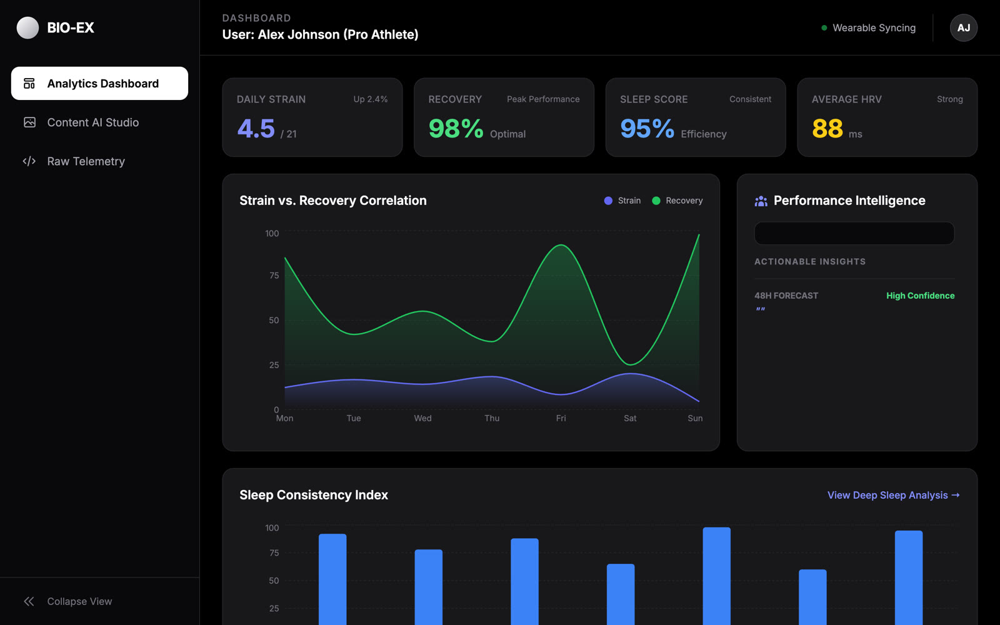

# Bio-Executive Analytics

[](https://github.com/otawfik/Bio-Executive-Analytics/actions/workflows/ci.yml)

**A performance dashboard for an athlete's wearable data, with AI-written insights and an AI
image studio for training content.**



*The dashboard runs on built-in sample data for one athlete.*

## What it does

- **Analytics dashboard.** Daily strain, recovery, sleep score and HRV at a glance; a
  strain-vs-recovery correlation chart and a sleep-consistency index across the week.
- **Performance intelligence.** The week's metrics go to `gemini-3-flash-preview` with a JSON
  response schema, and come back as structured, actionable insights and a 48-hour forecast.
- **Content AI studio.** Upload a training photo and describe an edit ("clean background",
  "cinematic retro filter"); `gemini-2.5-flash-image` returns the edited image.
- **Raw telemetry.** The underlying data, for anyone who wants the numbers.

**The API key never reaches the browser.** Every Gemini call goes through one server
function, `api/gemini.ts`, which holds `GEMINI_API_KEY` and only lets this app's models through.
The browser calls `/api/gemini` (`services/geminiClient.ts`).

## Run locally

```bash
npm install
echo "GEMINI_API_KEY=your-key" > .env.local   # never committed
npm run dev
```

In development Vite answers `/api/gemini` with the same server function, so there's nothing
else to run. Deploys to Vercel as-is; set `GEMINI_API_KEY` in the project's environment variables
and give the key a quota in Google AI Studio, since the endpoint is public.

## Stack

React 19 · TypeScript · Vite · Recharts · Tailwind CSS · Google Gemini API · Vercel Functions
